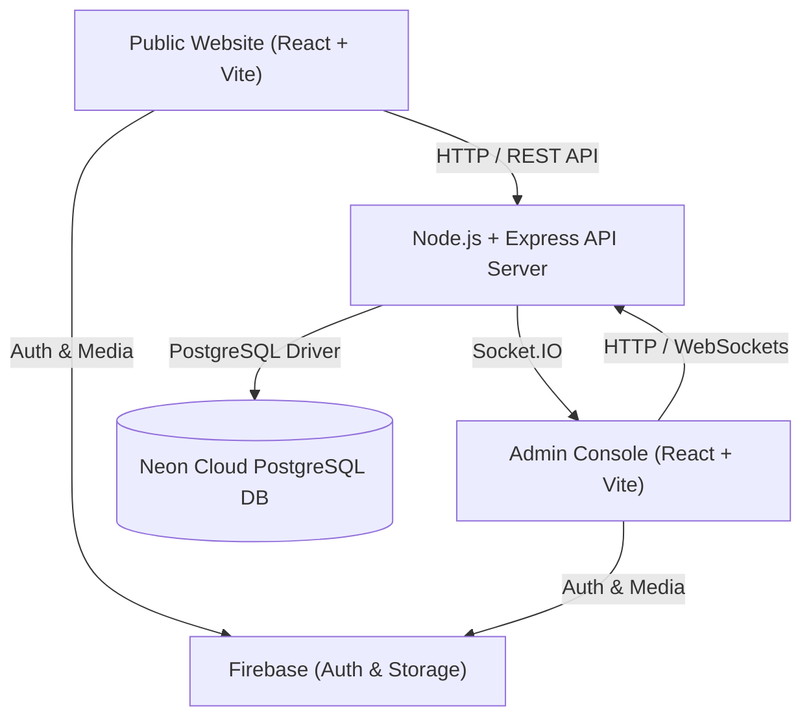

# 📰 TOP NEWS - Full-Stack Digital Media & Video Platform
## Complete Exhaustive Technical Documentation

**Prepared For**: Mentor Presentation & Viva Review  
**Date**: September 2026  
**File Location**: `project-docs/TOP_NEWS_PROJECT_COMPLETE_DOCUMENTATION.md`  

---

## 📋 Table of Contents
1. [Project Overview & Concept (પ્રોજેક્ટ પરિચય)](#1-project-overview--concept)
2. [Architecture & Tech Stack (આર્કિટેક્ચર અને ટેકનોલોજી)](#2-architecture--tech-stack)
3. [Complete Directory & File Structure (ફોલ્ડર અને ફાઇલ્સ)](#3-complete-directory--file-structure)
4. [Frontend Public Website (`top-news`)](#4-frontend-public-website-top-news)
5. [Frontend Admin & Reporter Console (`top-news-admin`)](#5-frontend-admin--reporter-console-top-news-admin)
6. [Backend Express API Server (`top-news-backend`)](#6-backend-express-api-server-top-news-backend)
7. [PostgreSQL Database Schemas & Neon Setup](#7-postgresql-database-schemas--neon-setup)
8. [Live System URLs & Connection Credentials](#8-live-system-urls--connection-credentials)
9. [Step-by-Step Mentor Presentation Script](#9-step-by-step-mentor-presentation-script)

---

## 1. Project Overview & Concept

**TOP NEWS** is an enterprise-grade digital news publishing and short-video streaming platform. It connects public news readers, accredited journalists/reporters, chief editors, and advertisers into a unified real-time ecosystem.

### Core Capabilities
- 🌍 **Multi-Lingual News Engine**: Serves articles and short videos across Gujarati, Hindi, and English.
- 🎬 **Short Video Reels Streamer**: Custom HTML5 & YouTube Shorts video player with CORS-safe high-speed CDN playback.
- 👥 **Role-Based Workflows**: Dedicated Admin Console for Chief Editors (`admin`) and Accredited Journalists (`reporter`).
- 📢 **Advertisement Manager**: Full banner campaign management with click counter analytics and client request approval workflow.
- 🔔 **Web Push Broadcast**: Browser notification engine using Web Push API & VAPID keys.
- 🌓 **Dark & Light Theme Engine**: Responsive UI/UX with active local persistence.
- 📱 **Mobile-First Architecture**: 100% responsive dock, zero overflow layout, 4-column equal grids for mobile screens.

---

## 2. Architecture & Tech Stack



### Technology Breakdown

| Layer | Technology | Role |
| :--- | :--- | :--- |
| **Public Website** | React 18, TypeScript, Vite, TailwindCSS, Framer Motion | News reading, video player, category search & filtering |
| **Admin Console** | React 18, TypeScript, Vite, Lucide Icons, React Query | Article CRUD, video manager, leave approval, press card generator |
| **Backend API Server** | Node.js, Express.js, Socket.IO, PostgreSQL `pg` driver | REST endpoints, real-time sync, VAPID push notifications |
| **Primary Cloud DB** | Neon Cloud PostgreSQL DB | Relational data store for news, videos, ads, leaves & users |
| **Storage & Auth** | Firebase Storage & Firebase Auth (`browserLocalPersistence`) | Images/video hosting, persistent mobile authentication |
| **Hosting Platform** | Vercel Cloud Platform | Production CDN hosting & CI/CD deployment |

---

## 3. Complete Directory & File Structure

```
post new project/
│
├── project-docs/
│   ├── TOP_NEWS_PROJECT_COMPLETE_DOCUMENTATION.txt  <-- Text Format
│   └── TOP_NEWS_PROJECT_COMPLETE_DOCUMENTATION.md   <-- Markdown Format
│
├── top-news/                                         <-- Public Website
│   └── src/
│       ├── components/ (layout, news, sections, ui)
│       ├── pages/ (HomePage, VideoPage, CategoryPage)
│       └── services/ (api.ts, videoService.ts)
│
├── top-news-admin/                                   <-- Admin & Reporter Panel
│   └── src/
│       ├── pages/ (Dashboard, Login, News, Videos, Ads, Reporter, Settings)
│       └── firebase/ (auth.ts, firestore.ts, config.ts)
│
└── top-news-backend/                                 <-- Node.js PostgreSQL API
    ├── src/
    │   ├── db/ (index.js - PostgreSQL Pool)
    │   └── routes/ (news.js, videos.js, ads.js, leaves.js, notifications.js)
    └── vercel.json
```

---

## 4. Frontend Public Website (`top-news`)

- **`Header.tsx` & Mobile Drawer**: Category links, search input bar, ThemeToggle.
- **`HeroSection.tsx` & `FeaturedSection.tsx`**: Homepage hero stories (`is_hero = true`) and trending topics.
- **`VideoPage.tsx`**: Dual player supporting HTML5 MP4s (`playsInline`, `preload="auto"`) and YouTube Shorts embeds.
- **`ThemeContext.tsx`**: Dynamic Dark / Light mode switching with localStorage persistence.

---

## 5. Frontend Admin Console & Reporter Portal (`top-news-admin`)

- **`firebase/auth.ts`**: Configured with `browserLocalPersistence` for mobile session stability.
- **`Layout.tsx`**: Mobile bottom dock navigation (Home, Articles, + New, Ads, Settings).
- **`NewsList.tsx`**: 1-Click `Set as Hero` toggle and responsive 2-column mobile action buttons.
- **`VideosList.tsx`**: Video reels list with multi-key API compatibility.
- **`AdsList.tsx`**: 2-column equal tab grid for Active Campaigns vs Client Requests.
- **`LeaveManagement.tsx`**: Reporter leave application & 4-column equal grid status filter.

---

## 6. Backend Express API Server (`top-news-backend`)

### Core Routes
- **News**: `GET /api/news`, `POST /api/news`, `PUT /api/news/:id`, `DELETE /api/news/:id`, `PATCH /news/:id/hero`
- **Short Videos**: `GET /api/short-videos`, `POST /api/short-videos`, `PATCH /short-videos/:id/views`
- **Ads**: `GET /api/ads`, `POST /ads/requests`, `PATCH /ads/requests/:id/approve`, `PATCH /ads/:id/click`
- **Leaves**: `GET /api/leaves`, `POST /leaves`, `PATCH /leaves/:id/status`

---

## 7. PostgreSQL Database Schemas & Neon Setup

- **Host**: `ep-plain-thunder-b38559px-pooler.c-4.ap-southeast-1.aws.neon.tech`
- **Database**: `neondb`
- **SSL Mode**: `Require`

### Tables SQL Structure
1. `news_articles` (id, title, slug, content, category, language, image_url, views, is_hero, status)
2. `short_videos` (id, title, slug, video_url, thumbnail_url, duration, category, topic, views, status)
3. `advertisements` (id, title, image_url, link_url, position, click_count, client_name, is_active)
4. `reporter_leaves` (id, reporter_name, leave_type, start_date, end_date, total_days, status)

---

## 8. Live System URLs & Credentials

1. **Public Website**: [https://top-newsss-project-ehji.vercel.app](https://top-newsss-project-ehji.vercel.app)
2. **Admin Console**: [https://top-newsss-project-rqnz.vercel.app](https://top-newsss-project-rqnz.vercel.app)
3. **Backend API**: [https://top-newsss-project.vercel.app/api/health](https://top-newsss-project.vercel.app/api/health)
4. **Short Videos API**: [https://top-newsss-project.vercel.app/api/short-videos](https://top-newsss-project.vercel.app/api/short-videos)

---

## 9. Step-by-Step Mentor Presentation Script

1. **Introduction**: Introduce TOP NEWS as a full-stack media streaming and news publishing platform.
2. **Database Migration**: Explain moving to relational Neon PostgreSQL for structured queries and indexing.
3. **Admin & Editorial**: Showcase 1-click Hero toggle, leave approval matrix, and client ad approval workflow.
4. **Mobile Responsiveness**: Highlight zero-overflow UI, 4-column equal grids, and persistent mobile auth.
